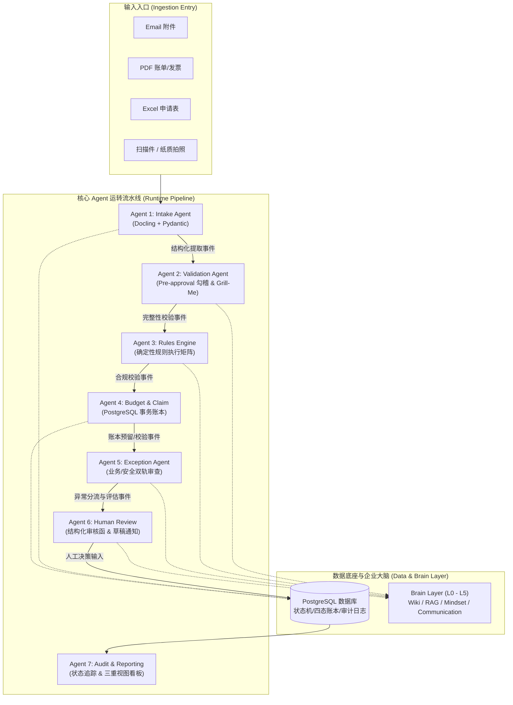
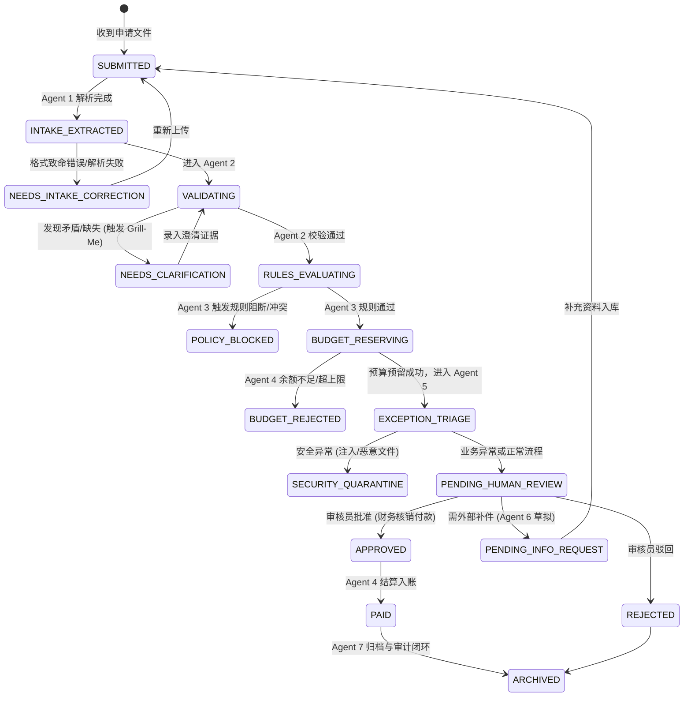

# 00 - 系统总架构与运转链路 (Architecture & End-to-End Pipeline)

## 1. 架构总览与核心设计哲学

为了解决「多渠道散乱录入、规则模糊冲突、预算重复扣减、人工反复审核、审计缺失」的痛点，本系统采用 **确定性工程底座 + LLM 语义推理 + 企业记忆脑层 (Brain Layer)** 的混合多 Agent 架构。



---

## 2. 状态机规范 (Submission Lifecycle State Machine)

每份申请在系统生命周期内具备严格确定的状态转移，严禁下游 Agent 越权跳级执行。



---

## 3. 标准 Agent 通讯事件合约 (Unified Event Schema)

系统之所以能够顺畅运转并实现可靠的 `Validate` 和 `Link`，核心在于每个 Agent 绝不自由发挥，必须消费和生产标准 JSON 合约：

```json
{
  "$schema": "https://json-schema.org/draft/2020-12/schema",
  "run_id": "run_20261010_9a01bf2",
  "submission_id": "SUB-2026-MY-0042",
  "parent_pre_approval_id": "PA-2026-Q3-018",
  "partner_id": "PTR-GLD-882",
  "partner_tier": "Gold",
  "timestamp": "2026-10-10T10:55:00Z",
  "source_agent": "validation",
  "target_agent": "rules_engine",
  "status": "NEEDS_CLARIFICATION",
  "payload": {
    "extracted_claim_amount": 15000.00,
    "currency": "MYR",
    "invoice_numbers": ["INV-88912", "INV-88913"],
    "activity_date": "2026-09-15",
    "attachments_count": 3
  },
  "validation_result": {
    "is_passed": false,
    "error_code": "INVOICE_AMOUNT_MISMATCH",
    "rule_id": "RULE_VAL_INVOICE_002",
    "severity": "WARNING",
    "open_questions": [
      {
        "question_id": "Q-01",
        "question": "上传的两张发票金额分别为 RM 10,000 与 RM 5,000，与申请总额 RM 15,000 是否为分笔开票，或其中一张为作废重开？",
        "evidence_refs": ["doc_inv_1:page_1", "doc_inv_2:page_1"]
      }
    ]
  },
  "evidence_refs": [
    {
      "doc_id": "doc_inv_1",
      "filename": "tax_invoice_final.pdf",
      "page": 1,
      "bounding_box": [120, 340, 280, 360],
      "confidence": 0.98
    }
  ]
}
```

---

## 4. 全系统运转与校验闭环 (How It Links & Validates)

### 4.1 链路连接机制 (Linkage Mechanism)
1. **全局主键追踪：** 每份申请在 Intake 时生成唯一全局键 `submission_id`，所有产生的中间提取表、证据片断、日志、数据库事务行均强制携带该键。
2. **前后向双向引用：** 
   - 报销单 (Claim) 必须向前强制绑定预审批单 `parent_pre_approval_id`。
   - 所有下游判定结果必须向后回溯到 Intake 阶段提取出的 `doc_id + page + bounding_box` 物理证据。
3. **Brain Layer 上下文注入：** 
   - 运行时只有高层元数据 (L0 Global Brief) 随请求常驻。
   - 遇到未决事项时，通过 L1 Router 精准装载所需 Skill（如 Agent 2 装载 Grill-Me，Agent 3 装载 Grill-With-Docs）。

### 4.2 全链路验证体系 (Validation Strategy)
1. **输入验证 (Input Gate)：** Pydantic 强类型与 Docling 解析置信度阈值过滤（置信度 < 0.85 强制挂起）。
2. **业务逻辑验证 (Rules Gate)：** 确定性规则矩阵（纯 Python/SQL 代码），0% 幻觉风险。
3. **财务一致性验证 (Ledger Gate)：** PostgreSQL 行级排他锁（`SELECT ... FOR UPDATE`），四状态严密守恒（`Allocated = Committed + Approved + Paid + Available`）。
4. **安全隔离验证 (Security Gate)：** 文件解析与沙盒双人审计机制，确认安全威胁才能进入阻断，避免业务误杀。
5. **最终决策闭环 (Human-in-the-Loop Gate)：** 任何异常或正常款项核准，最终批准动作由人工权限系统在 UI 界面点击并留存数字签名。
