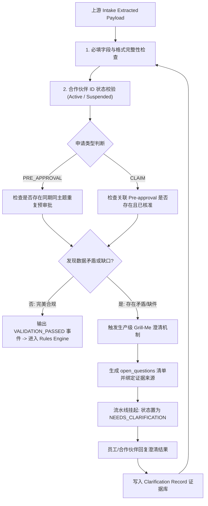

# 02 - Agent 2: Validation Agent (资料缺口发现与未知情况澄清)

## 1. 业务痛点与目标

| 项目 | 说明 |
| :--- | :--- |
| **当前痛点** | 员工需要肉眼核对必填字段完整性、核实合作伙伴有效性、人工排查是否重复申请。当申请人提交的文件互相矛盾（如上传了两份金额不同的发票），员工缺乏标准化流程，经常私下询问导致信息丢失。 |
| **核心目标** | 自动化验证数据完整性与资格勾稽；发现模棱两可或信息缺失时，结构化生成澄清问题；与上游预审批建立强制血缘关联。 |
| **参考技能** | [grill-me Skill](https://github.com/mattpocock/skills/blob/main/skills/productivity/grill-me/SKILL.md) 模式改良。 |

---

## 2. 核心验证职责与流转流程



---

## 3. 核心业务校验规则清单

1. **必填要素完整性 (Completeness Gate)：**
   - 申请人、合作伙伴编号、活动主题、预期/实际金额、日期、发票明细。
2. **合作伙伴身份核验 (Partner Identity Check)：**
   - 查询数据库合作伙伴主表，校验 `partner_id` 是否有效，当前所属等级 (`Tier`: Elite, Gold, Silver, Registered)。
3. **报销与预审批勾稽 (Claim-to-PreApproval Linkage)：**
   - 若类型为 `CLAIM`，必须提供 `parent_pre_approval_id`。
   - 校验对应预审批单状态是否为 `APPROVED`。若预审批仍在审核中或已被拒绝，直接阻断报销流转并提示 `PRE_APPROVAL_NOT_READY`。
4. **防重复提交 (Deduplication Check)：**
   - 发票号码查重：校验 `invoice_numbers` 是否已被历史报销单录入（全局唯一性索引）。
   - 相同合作伙伴 + 相同活动日期 + 相同金额的近 90 天记录查重。

---

## 4. Grill-Me 技能在生产环境中的工程化落地

### 4.1 关键认知与限制
> **重要认知：** 开源的 `grill-me` 技能本质是一种深度访谈策略，适用于工程师与交互式 Agent 对话，**它不是直接运行在后端的自动化校验算法**。
>
> **工程落地改造方案：** 我们必须将 Grill-Me 转化为生产系统中的 **「提问生成 (Ask) - 挂起等待 (Pause) - 结构化记录 (Record) - 状态恢复 (Resume)」** 机制。

### 4.2 典型场景示例：双发票金额冲突
- **发现冲突：** 申请人上传了两张发票（一张 RM 10,000，一张 RM 5,000），但申请表总额写着 RM 10,000。
- **严禁行为：** Agent 绝对禁止“聪明地猜测”哪张发票才是最终版。
- **Grill-Me 提问生成结构：**

```json
{
  "submission_id": "SUB-2026-MY-0042",
  "status": "NEEDS_CLARIFICATION",
  "clarification_request": {
    "round": 1,
    "questions": [
      {
        "question_id": "CLR-Q1",
        "category": "INVOICE_CONFLICT",
        "question": "检测到上传了 2 张发票：发票 A (INV-01, RM 10,000) 与 发票 B (INV-02, RM 5,000)，但报销申请总额为 RM 10,000。请澄清：(1) 发票 B 是否为发票 A 的定金凭单；或 (2) 发票 A 为最终作废重开件？",
        "evidence_sources": [
          {"doc_id": "doc_101", "filename": "INV-01.pdf", "page": 1},
          {"doc_id": "doc_102", "filename": "INV-02.pdf", "page": 1}
        ],
        "options": [
          "发票 A 为最终发票，发票 B 属误传",
          "两张发票合并报销（需更正申报金额为 RM 15,000）",
          "人工上传新发票替换"
        ]
      }
    ]
  }
}
```

### 4.3 澄清证据沉淀 (Clarification Record)
当运营人员或合作伙伴选择/回答后，系统将其记录至不可篡改的 `clarification_records` 表：
- `record_id`: CLR-REC-20261010-01
- `submission_id`: SUB-2026-MY-0042
- `question_id`: CLR-Q1
- `answered_by`: ops_officer_john@company.com
- `resolution`: "发票 A 为最终发票，发票 B 属误传作废"
- `timestamp`: 2026-10-10T11:05:00Z

该记录随事件传递给后续 Agent 3 (Rules Engine) 和 Agent 6 (Human Review)，**下游无需再次提问**。

---

## 5. Token 消耗优化 (Token Optimization)

1. **单轮聚合提问 (Single-Round Batching)：**
   - 扫描出所有缺失字段与矛盾后，严禁来回多次发起单题提问。统一聚合生成一个结构化清单（最多 1 轮澄清互动）。
2. **持久化避免重提：**
   - 已澄清的答案直接打上数据戳并持久化在数据库中，后续 Agent 3 和 Agent 4 遇到相关字段直接取用结构化答案，杜绝重复消耗上下文。
