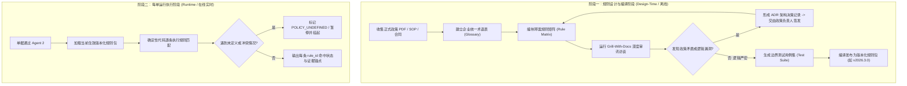

# 03 - Agent 3: Rules Engine (规则严密性验证与执行引擎)

## 1. 业务痛点与目标

| 项目 | 说明 |
| :--- | :--- |
| **当前痛点** | 报销与审批规则分散在多个 PDF 文件、内部 SOP 以及销售政策 Excel 中。不同部门发布的政策往往版本脱节、条件冲突（如补贴上限不同）、缺乏边界情况说明，导致全凭员工个人经验判断。 |
| **核心目标** | 将分散政策在**设计阶段**经过严格审查与访谈，提炼成版本化、确定性的「规则矩阵 (Rules Matrix)」；在**运行阶段**进行确定性执行，严禁 LLM 现场捏造政策。 |
| **参考技能** | [grill-with-docs Skill](https://github.com/mattpocock/skills/tree/main/skills/engineering/grill-with-docs) 模式迁移。 |

---

## 2. 规则生命周期双阶段架构



---

## 3. 设计阶段实施：从文档到规则矩阵

### 3.1 统一术语表 (Glossary Baseline)
在 `docs/brain/glossary/` 中规范核心定义：
- **Partner Tier:** Registered (0级), Silver (1级), Gold (2级), Elite (3级)。
- **Pre-approval Cap:** 预审批单次最高核准上限。
- **Co-op Reimbursement Ratio:** 联合营销报销比例（如 Gold 级别 50%，Elite 级别 70%）。
- **Submission Window:** 活动结束后必须提交 Claim 的最晚期限（如 30 天内）。

### 3.2 典型规则冲突与 Grill-With-Docs 发现机制
- **冲突案例：**
  - SOP 文件 `SOP_2025_V2.pdf` 写明：“Gold Tier 单次活动最高补贴上限为 RM 8,000”。
  - 销售政策简报 `Partner_Incentive_2026_Q1.pdf` 写明：“Gold Tier 活动上限为 RM 10,000”。
- **Grill-With-Docs 介入：**
  - 在规则设计期，Agent 自动比对两份文档，发现金额冲突，输出提问：“发现文件 A 与 B 存在金额上限冲突 (RM 8,000 vs RM 10,000)。请确认哪个文件具备优先权，并注明生效起始日。”
- **架构决策记录 (ADR 003):**
  - **决策：** 2026年3月1日起，统一采用 `Partner_Incentive_2026_Q1` 的 RM 10,000 规则；旧活动按活动日期回溯判定。
  - **签署人：** 亚太区业务副总裁 & 财务总监。

### 3.3 规则矩阵规格 (Compiled Rule Matrix)

| 规则代码 (rule_id) | 规则名称 | 校验逻辑 | 触发阻断级别 | 政策来源依凭 |
| :--- | :--- | :--- | :--- | :--- |
| `R-DATE-001` | 报销时效检查 | `claim_date - activity_date <= 30` 天 | 警告并需特批 | `policies/claim-eligibility.md#sec-3` |
| `R-RATIO-002` | 报销比例上限 | 申报报销款不得超过发票合格金额的比例（Gold: 50%） | 强制阻断 | `policies/tier-benefits.md#table-2` |
| `R-CAP-003` | 单次额度上限 | `claim_amount <= tier_cap` (Gold: RM 10,000) | 强制阻断 | `policies/budget-calculation.md#rule-4` |
| `R-MATCH-004` | 预审批金额一致 | `claim_amount <= pre_approval_approved_amount` | 强制阻断 | `policies/pre-approval.md#sec-1.2` |

---

## 4. 运行阶段规范：严禁 LLM 自由发挥

1. **确定性执行 (Deterministic Runtime)：**
   - 运行时**不使用 LLM 解释政策**，而是使用已编译的 Python/SQL 规则代码执行。
2. **规则执行输出合约 (Output Schema)：**

```json
{
  "submission_id": "SUB-2026-MY-0042",
  "rule_engine_version": "v2026.3.0",
  "all_passed": false,
  "evaluated_rules": [
    {
      "rule_id": "R-DATE-001",
      "status": "PASSED",
      "metric": "14 days elapsed (limit 30)"
    },
    {
      "rule_id": "R-CAP-003",
      "status": "FAILED",
      "error_code": "AMOUNT_EXCEEDS_TIER_CAP",
      "metric": "Claim amount RM 15,000 exceeds Gold Tier limit of RM 10,000",
      "policy_ref": "policies/budget-calculation.md#rule-4",
      "evidence_refs": ["doc_inv_1:page_1"]
    }
  ]
}
```

3. **未知条件安全回退 (Safe Fallback)：**
   - 只要遇到规则矩阵中未穷举的情形，系统立即返回 `STATUS: REQUIRES_POLICY_INTERPRETATION`，移交至政策负责人，绝不允许 Agent 现场替公司决定政策。

---

## 5. Token 与运维优化

- **离线访谈，零在线消耗：** Grill-With-Docs 仅在政策发布、修改或季度规则升级时离线运行。
- **运行时 0 Token：** 业务每日前进的数千份申请执行确定性代码匹配，LLM Token 消耗为 0，毫秒级响应，100% 确定性。
