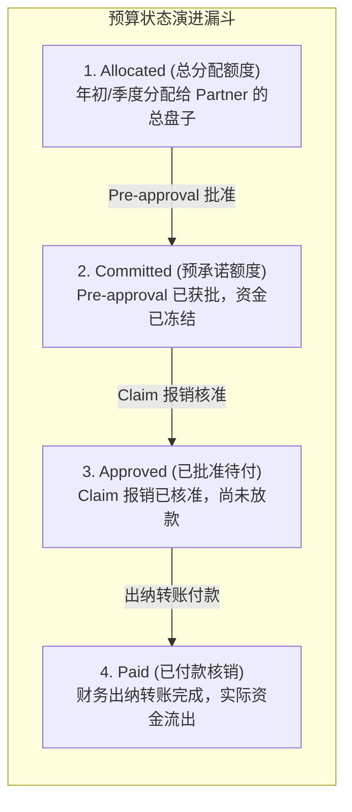

# 04 - Agent 4: Budget & Claim Verification (预算与报销核对)

## 1. 业务痛点与目标

| 项目 | 说明 |
| :--- | :--- |
| **当前痛点** | 财务与运营人员需要反复查阅分散的 Excel 总表，手动核对初始获批预算、已发生金额与当前报销额。多人同时操作极易出现并发冲突、超额承诺，或者因网络重试导致预算重复扣减。 |
| **核心目标** | 建立严密可靠的四态预算账本 (Allocated, Committed, Approved, Paid)；利用数据库 ACID 事务行级排他锁，彻底杜绝并发超额承诺与重复扣除；0% 借助 LLM 做财务加减法。 |
| **实施技术** | **PostgreSQL** + 行级锁事务 (`FOR UPDATE`) + 幂等操作流水号 (`idempotency_key`) + 确定性账本引擎。 |

---

## 2. 核心架构：四态预算账本模型 (Four-State Ledger Model)

任何一家合规企业的营销或渠道预算，都必须严格区分以下四个状态，绝不可混为一谈：



### 核心财务守恒定律 (Financial Invariant):
$$\text{Available Budget} = \text{Allocated} - (\text{Committed} + \text{Approved} + \text{Paid})$$
*任何时候，系统若计算出 $\text{Available Budget} < 0$，立即触发硬中断阻断！*

---

## 3. PostgreSQL 事务更新与防并发机制

### 3.1 数据库表结构设计 (DDL)

```sql
-- 合作伙伴总账表
CREATE TABLE partner_budget_ledger (
    partner_id VARCHAR(64) NOT NULL,
    fiscal_year INT NOT NULL,
    allocated_amount NUMERIC(14, 2) NOT NULL DEFAULT 0.00,
    committed_amount NUMERIC(14, 2) NOT NULL DEFAULT 0.00,
    approved_amount NUMERIC(14, 2) NOT NULL DEFAULT 0.00,
    paid_amount NUMERIC(14, 2) NOT NULL DEFAULT 0.00,
    updated_at TIMESTAMP WITH TIME ZONE DEFAULT CURRENT_TIMESTAMP,
    PRIMARY KEY (partner_id, fiscal_year)
);

-- 预算操作明细流水表 (不可变账本，用于追溯审计)
CREATE TABLE budget_transactions (
    transaction_id UUID PRIMARY KEY DEFAULT gen_random_uuid(),
    idempotency_key VARCHAR(128) UNIQUE NOT NULL, -- 幂等键，防止重试重复扣减
    submission_id VARCHAR(64) NOT NULL,
    partner_id VARCHAR(64) NOT NULL,
    transaction_type VARCHAR(32) NOT NULL, -- RESERVE_COMMIT, COMMIT_TO_APPROVE, RELEASE_COMMIT, PAY
    amount NUMERIC(14, 2) NOT NULL,
    rule_version VARCHAR(32) NOT NULL,
    created_at TIMESTAMP WITH TIME ZONE DEFAULT CURRENT_TIMESTAMP
);
```

### 3.2 确定性事务执行伪代码 (原子更新)

```python
def reserve_pre_approval_budget(db_conn, submission_id: str, partner_id: str, amount: float, idempotency_key: str):
    """
    预审批通过时，原子化锁定并增加 committed_amount
    """
    with db_conn.transaction():
        # 1. 检查幂等键，防止重试攻击
        existing_tx = db_conn.execute(
            "SELECT transaction_id FROM budget_transactions WHERE idempotency_key = %s",
            (idempotency_key,)
        ).fetchone()
        if existing_tx:
            return {"status": "ALREADY_PROCESSED", "tx_id": existing_tx[0]}

        # 2. 行级加锁查询当前总账
        ledger = db_conn.execute(
            """
            SELECT allocated_amount, committed_amount, approved_amount, paid_amount 
            FROM partner_budget_ledger 
            WHERE partner_id = %s AND fiscal_year = 2026
            FOR UPDATE
            """,
            (partner_id,)
        ).fetchone()

        if not ledger:
            raise ValueError(f"Partner {partner_id} has no budget allocated for 2026.")

        allocated, committed, approved, paid = ledger
        available = allocated - (committed + approved + paid)

        # 3. 严格校验可用额度
        if amount > available:
            return {
                "status": "INSUFFICIENT_BUDGET",
                "available": float(available),
                "requested": float(amount)
            }

        # 4. 执行原子更新
        db_conn.execute(
            """
            UPDATE partner_budget_ledger
            SET committed_amount = committed_amount + %s,
                updated_at = CURRENT_TIMESTAMP
            WHERE partner_id = %s AND fiscal_year = 2026
            """,
            (amount, partner_id)
        )

        # 5. 写入不可变审计流水
        db_conn.execute(
            """
            INSERT INTO budget_transactions (idempotency_key, submission_id, partner_id, transaction_type, amount, rule_version)
            VALUES (%s, %s, %s, 'RESERVE_COMMIT', %s, 'v2026.3.0')
            """,
            (idempotency_key, submission_id, partner_id, amount)
        )

        return {"status": "SUCCESS", "new_available": float(available - amount)}
```

---

## 4. 关键风险与防护手段 (Risk & Defense)

| 风险情景 | 潜在危害 | 防护手段 |
| :--- | :--- | :--- |
| **网络抖动与接口重试** | 重试请求导致预算被重复扣减两次。 | 强制校验唯一的 `idempotency_key`（由 `submission_id + action + run_id` 生成）。若键已存在，直接返回先前结果，不重复扣算。 |
| **并发超额申请 (Race Condition)** | 两个人同时提报 RM 6,000，当前只剩 RM 8,000，由于读脏数据两人均获批准。 | 使用 PostgreSQL `FOR UPDATE` 排他锁。后来的事务强制等待排队，确保读取的是最新计算后的 `available`。 |
| **已承诺与已付款混淆** | 报销完成时忘了冲销 Committed，反而直接加算 Paid，导致账面重复扣款。 | 状态转移必须是原子性的转移：`committed -= X` 且 `approved += X`。每日凌晨运行财务对账脚本，核查总和。 |

---

## 5. Token 消耗优化 (Token Optimization)

- **AI 不碰财务计算：** 正常的账本查询、可用额度比对、报销上限扣算 **100% 采用确定性 Python/SQL 代码完成**，不调用任何 LLM。
- **仅异常时调用：** 只有当发票币种需要历史汇率换算、或发票明细存在复杂的折扣与税率需要文本语义解释时，才将局部片段交由 LLM 辅助解释。
