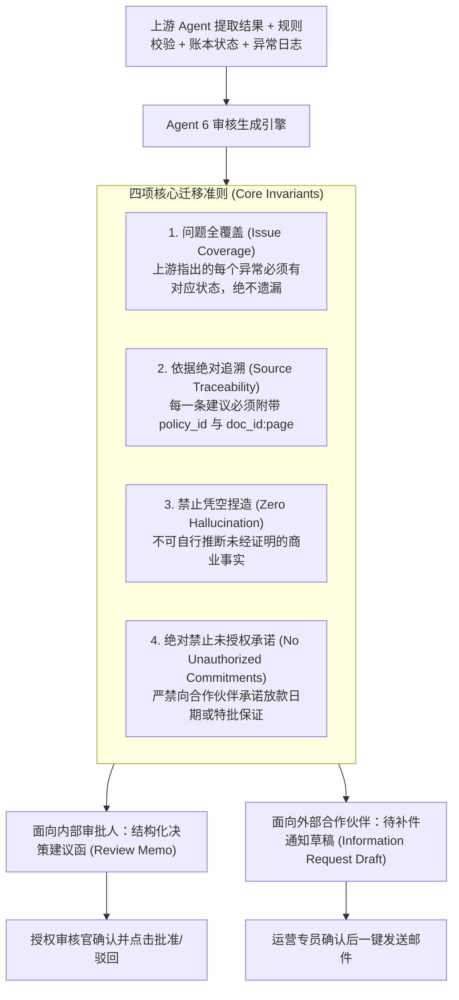

# 06 - Agent 6: Human Review & Workflow Agent (人工审核辅助与沟通草稿)

## 1. 业务痛点与目标

| 项目 | 说明 |
| :--- | :--- |
| **当前痛点** | 审批人员需要重新逐页阅读整份申请、自行理清为什么被系统打回，还要绞尽脑汁撰写格式规范的补件通知邮件、拒批理由或向上级汇报的内部备忘录，耗费大量脑力且容易承诺过度。 |
| **核心目标** | 汇总上游所有 Agent 结论，自动生成高信息密度的「审核摘要」与「通知建议草稿」；实行严格的证据溯源与政策锚定；**终审裁决权 100% 保留在企业人工手中**。 |
| **参考技能** | [Response-to-Reviewers Skill](https://github.com/wanshuiyin/Auto-claude-code-research-in-sleep/blob/main/skills/rebuttal/SKILL.md) 原则改造。 |

---

## 2. Response-to-Reviewers 核心原则在企业审批中的迁移

开源的 Response-to-Reviewers 原本用于学术顶刊论文对审稿人意见的逐条辩驳。我们将其严谨的方法论迁移至企业合规报销场景：



---

## 3. 标准审核建议函结构 (Standard Review Memo Format)

Agent 6 为内部审批主管生成的报告具备固定严谨的 6 段式结构：

```markdown
Subject: Partner Claim Review — SUB-2026-MY-0042 (MegaTech Solutions)

### 1. 申请摘要 (Submission Summary)
- 合作伙伴: MegaTech Solutions (ID: PTR-GLD-882, Tier: Gold)
- 关联预审批: PA-2026-Q3-018 (已获批额度: RM 10,000.00)
- 本次报销申报额: RM 15,000.00 | 活动日期: 2026-09-15 | 申报日期: 2026-10-02

### 2. 已完成的系统核对 (Completed Verifications)
- [x] 合作伙伴资质: 正常生效中 (Active)
- [x] 关联预审批状态: 已核准，资金承诺记录正常
- [x] 提交时效检查: 17 天内提报 (符合 30 天规定)
- [x] 发票唯一性检查: 发票号 INV-88912 无重复记录
- [ ] 申报金额上限核对: 异常 (超出等级报销限额)

### 3. 待解决问题及对应证据 (Outstanding Issues & Evidence)
- **问题 1 (超额申请):** 申报金额 RM 15,000.00 超出该活动关联的预审批上限 RM 10,000.00，超出 RM 5,000.00。
  - *证据锚点:* [发票 INV-88912](file:///docs/doc_inv_1#L1) (RM 15,000) vs [预审批批文 PA-2026-Q3-018](file:///docs/doc_pa_1#L12) (RM 10,000)。
- **问题 2 (活动成果证明缺失):** 未检测到合规的现场照片与参会人员签到表。
  - *证据锚点:* 附件清单中仅包含税务发票与报价单。

### 4. 建议采取的行动 (Recommended Action)
- [ ] 选项 A (按预审批上限核准): 核准 RM 10,000.00，超出的 RM 5,000.00 予以核减。
- [ ] 选项 B (挂起要求补件): 向合作伙伴发出补件通知，要求提供活动签到表与现场照片。
- [ ] 选项 C (整体驳回): 因材料不全及严重超额，驳回本次申请。

### 5. 需要审批人确认的事项 (Items Requiring Approver Sign-Off)
1. 是否同意豁免超出预审批的 RM 5,000.00？(需要 VP 级特批权限)
2. 是否允许延后 5 个工作日内补交活动现场签到表？

### 6. 相关政策与文件引用 (Policy Citations)
- [Gold 级别补贴报销上限规定 (Cap Rule)](policies/budget-calculation.md#rule-4)
- [活动现场佐证材料合规指引](policies/claim-eligibility.md#sec-proofs)
```

---

## 4. 防护机制：四重「承诺禁令」与来源校验

为防止 AI 生成让公司陷入法律或商业纠纷的内容，设置严格的防线：

1. **承诺禁令关键词检测 (Commitment Filter)：**
   - 严禁草稿中出现 *"We guarantee payment by..."*、*"Your claim is approved"*、*"Exception is granted"* 等断言。
   - 必须统一采用 *"Pending final approval"*, *"Subject to committee review"* 等中立客观措辞。
2. **草稿隔离 (Draft-Only State)：**
   - 系统生成的所有对外邮件与决定，**默认状态均为 `DRAFT_PENDING_REVIEW`**。
   - 只有具备系统权限凭据的正式员工在 UI 界面点击「确认发送」并记录操作人工号后，通知才会流出系统。
3. **政策引用真实性强制核对：**
   - 每一条 `policy_id` 必须在知识库 L2 Policy Wiki 中存在索引，杜绝模型幻觉编造政策条款。

---

## 5. Token 消耗优化 (Token Optimization)

- **输入剪枝：** 给 Agent 6 的 Prompt 中仅输入：
  1. 上游各 Agent 输出的结构化结果 JSON (约 400 Token)
  2. 命中规则涉及的简短政策条款 (约 200 Token)
  3. L5 通讯模板 (约 150 Token)
- **不输入任何完整的历史大文件：** 整体上下文严格控制在 1,500 Token 以内，确保高质量输出与低推理延迟。
