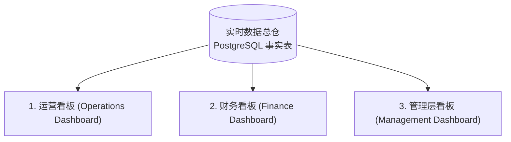

# 07 - Agent 7: Workflow, Audit & Reporting (全程审计、时效追踪与多维看板)

## 1. 业务痛点与目标

| 项目 | 说明 |
| :--- | :--- |
| **当前痛点** | 申请流转状态黑盒，责任人不清；案件严重逾期或卡在某人手中无法度量 (Ageing 无法追踪)；运营、财务与管理层各自维护一套 Excel 报表，口径不一，历史审批与判定过程无法溯源。 |
| **核心目标** | 建立全链路不可篡改审计追踪 (Audit Trail)；实时计算案件时效与处理责任人；提供面向运营、财务与管理层的三套专属看板；支持按合作伙伴、区域、等级、计划与状态灵活多维透视。 |
| **方法论借鉴** | [obra/superpowers](https://github.com/obra/superpowers) (系统工程研发质量保证) + **RefChecker** (来源防虚构核查)。 |

---

## 2. 软件研发与知识维护标准 (Superpowers & RefChecker)

### 2.1 Superpowers 开发期工作流准则
在构建和维护本 Agent 系统时，全面践行 Superpowers 提炼的 6 步工程纪律：
1. **Brainstorming:** 在编写代码前，与业务负责人彻底澄清边缘情况。
2. **Writing Plans:** 将复杂审批流拆解为单步可验证的小任务。
3. **Test-Driven Development (TDD):** 针对金额计算与规则矩阵，先写失败用例（如并发测试、千分位溢出测试），再写业务代码。
4. **Systematic Debugging:** 发现规则错误时寻找政策或解析根因，严禁只修补特定单据表象。
5. **Verification Before Completion:** 任何发布前必须跑通沙盒回放测试集。
6. **Code Review:** 关键规则变更必须由第二位工程师或业务专家同行评审。

### 2.2 RefChecker：知识引用与外部来源真伪审查
- 针对 Brain Layer (L2 Policy Wiki 与 L3 RAG) 中收录的所有政策条文、SOP 附件：
  - 定期运行来源检查器，验证引用的政策文档 ID 是否真实存在于知识底座中。
  - 核查页码、发布日期和版本有效性，自动剔除已作废的旧规引用。

---

## 3. 应用级审计跟踪与恢复机制 (Audit Trail & Resilience)

### 3.1 统一审计事件协议 (Immutable Audit Event)

每一步系统流转、规则判定与人工干预，均记录到 PostgreSQL 只读审计表 `submission_audit_events`：

```json
{
  "event_id": "EVT-20261010-88129",
  "submission_id": "SUB-2026-MY-0042",
  "run_id": "RUN-01",
  "actor": "agent_rules_engine",
  "actor_type": "SYSTEM_AGENT",
  "previous_state": "VALIDATED",
  "new_state": "RULE_EVALUATED_WITH_FAILURES",
  "error_code": "AMOUNT_EXCEEDS_TIER_CAP",
  "rule_id": "R-CAP-003",
  "evidence_refs": ["doc_inv_1:page_1", "policies/budget-calculation.md#rule-4"],
  "details": {
    "claimed": 15000.00,
    "cap_limit": 10000.00,
    "diff": 5000.00
  },
  "created_at": "2026-10-10T10:55:22.182Z"
}
```

### 3.2 根因定位与断点恢复 (Error Isolation & Recovery)
- **区分发现与根因：** 记录格式中清晰区分 `observed_symptom` (如发票与预审批金额不符) 与 `root_cause` (申请人错把全额总账单上传，未剔除自付部分)。
- **可恢复状态设计：** 若某一 Agent 执行失败，单据停留在当前状态的 `RECOVERABLE_ERROR` 节点，管理员修复网络或更新规则后可直接点击「重放当前步骤」，无需从 Intake 第一步重来。

---

## 4. 三大专属看板与多维报表体系 (Dashboard Views)

为满足不同角色对数据的敏锐度，系统生成针对性的三重视图：



### 4.1 运营看板 (Operations View) — 关注任务流转与瓶颈
- **待处理任务队列 (Actionable Worklist):** 按紧急程度 (SLA) 排序，高亮超过 48 小时未处理单据。
- **责任归属矩阵 (Ownership & Ageing):** 
  - 待合作伙伴补件 (Ageing: 5天)
  - 待运营初审 (Ageing: 1天)
  - 待总监特批 (Ageing: 3天)
- **卡点热力图：** 显示由于哪类缺件（如发票模糊、缺少签到表）导致的积压最多。

### 4.2 财务看板 (Finance View) — 关注资金占用与合规
- **实时四态资金池水位：**
  - `Allocated` (总盘子): RM 10,000,000
  - `Committed` (预审批占用): RM 4,200,000
  - `Approved` (已审核待付): RM 800,000
  - `Paid` (已实际放款): RM 3,500,000
  - `Available` (剩余可用): RM 1,500,000
- **付款预测与现金流匹配：** 未来 14 天内预期放款金额排期。
- **发票查重与税务合规率：** 异常发票告警列表。

### 4.3 管理层看板 (Management Executive View) — 关注 ROI 与宏观表现
- **全局处理吞吐量：** 月度申请总量、自动化直通率 (STP Rate)、平均审核周期由 14 天缩短至 2 天。
- **多维度交叉下钻报表 (Multi-dimensional Reporting):**
  - **按伙伴 (By Partner):** Top 10 申领伙伴与核销比例。
  - **按区域 (By Region):** 马来西亚、新加坡、印尼分部预算消耗对比。
  - **按等级 (By Tier):** Elite, Gold, Silver 伙伴参与活跃度。
  - **按计划 (By Programme):** Q3 联合营销、展会补贴、数字广告激励效果对比。
  - **按状态 (By Status):** 通过率、驳回率与特批率趋势。
