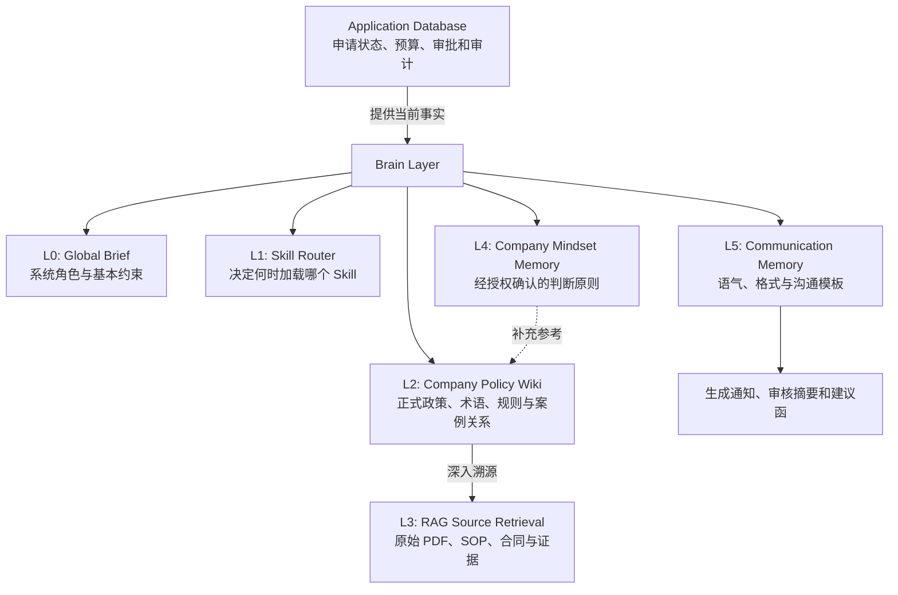
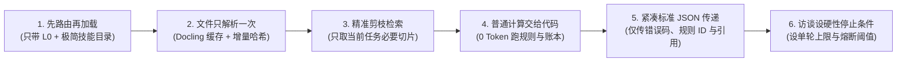

# 08 - Brain Layer 企业大脑知识体系 (五层架构与 Token 深度优化)

## 1. 架构定位：超越传统向量数据库

普通 RAG 主要解决「资料在哪里」；企业级的 **Brain Layer** 还要解决：
- **公司知道什么？** (结构化政策、术语与规则矩阵)
- **公司如何判断？** (管理层历史裁量权与心智模式)
- **为什么过去这样决定？** (经审计批准的真实业务原则)

系统绝不把所有内容粗暴塞进一个巨大向量数据库，而是构建**五层企业知识系统 (L0 - L5)**，并通过底层应用程序数据库 (Application Database) 持续提供实时事实。



---

## 2. 五层知识架构深度规范

### L0：Global Brief — 最小化全局记忆 (200–400 Tokens)
保存所有 Agent 都必须知道的基础信息与硬性红线：
1. **系统定位：** 企业合作伙伴渠道报销与预审批自动化处理系统。
2. **不可突破的红线 (Invariants)：**
   - **AI 不能自行完成最终审批：** 最终付款与放款裁决权 100% 留在人工授权专员手中。
   - **预算金额以数据库为准：** 预算计算以 PostgreSQL 事务账本为单一真实源 (SSOT)，AI 不碰加减法。
   - **正规政策与非正式经验严格分离：** 正式法律政策与管理层经验 (Mindset) 必须分轨标明。
   - **统一标准事件协议：** 遇到无法识别的字段必须返回明确错误代码，禁止自动猜测。
   - **统一来源引用规范：** 所有结论必须携带 `doc_id:page#coordinate`。

---

### L1：Skill Router — 按需调用技能 (On-Demand Loading)
不将所有 `SKILL.md` 全部常驻在提示词中，而是由路由器根据单据流转触发条件精准装载：

| 触发业务条件 | 动态加载的 Skill | 核心功能与落地方式 |
| :--- | :--- | :--- |
| 需要明确新规则或解决未知条件（如双发票冲突） | [`grill-me`](../skills/grill-me/SKILL.md) | 生成结构化澄清问题清单，挂起单据并等待确认 |
| 制定或修改业务政策、合并冲突规则 | [`grill-with-docs`](../skills/grill-with-docs/SKILL.md) | 对规则设计进行深度审讯，生成统一术语表与 ADR |
| 开发、调试或重构 Agent 系统底层代码 | [`superpowers`](../skills/superpowers/SKILL.md) | 践行 TDD、系统化根因调试、任务拆解与发布前验证 |
| 出现具体安全风险（Prompt 注入、恶意附件） | [`security-audit`](../skills/security-audit/SKILL.md) | 独立 Agent 证伪与沙盒隔离取证 (Cloudflare 规范) |
| 需要根据人工修正反馈提炼长期经验 | [`distill`](../skills/distill/SKILL.md) | 从审批历史日志聚类提取候选 Mindset 原则 |
| 生成审核意见、决策备忘录或补件回复草稿 | [`response-to-reviewers`](../skills/response-to-reviewers/SKILL.md) | 证据全覆盖、依据追溯、禁止虚构与未经批准承诺 |

---

### L2：Company Policy Wiki — 企业知识 Wiki (LLM-Wiki)
将厚重的 PDF 手册编译为相互链接的结构化 Markdown 页面（位于 [`company-brain/`](../company-brain/) 目录）：

```text
company-brain/
├── INDEX.md                         # 知识库主索引导航
├── glossary/                        # 统一术语定义
│   ├── partner-tier.md              # 伙伴等级 (Elite, Gold, Silver, Registered)
│   └── budget-terms.md              # 四态账本概念定义
├── policies/                        # 正式生效政策 (标注生效日期与版本号)
│   ├── pre-approval.md              # 预审批准入时限与门槛
│   ├── claim-eligibility.md         # 可报销范围与合规证明
│   └── budget-calculation.md        # 补贴上限与分摊核算公式
├── workflows/                       # 标准操作流程 SOP
│   ├── submission-lifecycle.md      # 生命周期状态机
│   └── exception-handling.md        # 业务与安全异常双轨处理
├── cases/                           # 典型历史判定案例集
│   ├── missing-document.md
│   └── over-budget.md
├── mindset/                         # L4 经审批确认的心智原则
│   └── approved-principles.md
└── communication/                   # L5 统一沟通模板
    └── review-templates.md
```

*约束：每一条重要政策必须关联原始文件、版本、生效日期与页码。发生冲突时返回正式政策来源核实，**绝不能把 AI 摘要当成正式政策**。*

---

### L3：RAG — 原始文件检索 (Ground-Truth Evidence)
- **底层资产：** 公司盖章合同、官方 SOP、发票原件与活动照片。
- **检索输出：** 混合检索过滤出最相关的少量片段，附带 `doc_id`、页码、版本与生效日期。
- **冲突处理：** 发现条款冲突时同时展示双方证据来源，触发政策澄清流程。
- **证据不足阻断：** 找不到足够证据时明确返回 `INSUFFICIENT_EVIDENCE`，严禁靠模型记忆补全。
- **Wiki 与 RAG 的分工：**
  - **Wiki (L2):** 负责提供已整理的**结构化知识与关系**。
  - **RAG (L3):** 负责提供不可篡改、可核实的**原始法律证据**。

---

### L4：Company Mindset Memory — 让公司教会 AI 如何判断
沉淀管理层的裁量权与业务倾向（参考 [Distill Skill](../skills/distill/SKILL.md)）：

```
人工审批 / 修正 AI 结果
       ↓
记录案例明细、结果及裁量原因 (PostgreSQL 事实表)
       ↓
识别重复出现的判断模式 (聚合 ≥ 5 次特批)
       ↓
生成待审核的《Mindset Proposal (提案)》
       ↓
检查是否与正式政策/法律法规冲突
       ↓
公司授权人员 (Director/VP) 签署批准
       ↓
建立版本化的长期记忆 (存入 company-brain/mindset/approved-principles.md)
       ↓
未来同类任务在 Agent 6 审核时按需检索
```

#### 标准 Mindset 数据结构：
```json
{
  "principle_id": "MINDSET_001",
  "principle": "优先处理证据不足的高金额申请，并在建议函中重点提示核减风险",
  "scope": "claim_triage",
  "basis": "Approved across 28 historical quarterly audit cases",
  "authority": "management_approved_by_Operations_Director",
  "policy_override_allowed": false,
  "version": 1
}
```
*铁律：历史经验可以改善优先级排序与建议倾向，但**绝对禁止覆盖正式政策、财务硬约束与人工终审权限**。不从一两个偶发案例提炼永久规则。*

---

### L5：Communication Memory — 统一沟通方式 ([Boss Communication](../skills/boss-communication/SKILL.md))
保障系统面对不同角色的专业表达：
1. **申请人/合作伙伴：** 礼貌专业、列明待补材料、给出截止日，**不作未批准的付款承诺**。
2. **营运人员：** 任务导向、标注 SLA 逾期时长与卡点清单。
3. **财务人员：** 严谨保守、突出金额差异、发票合规性与四态预算池变动。
4. **管理层 (The Boss)：** 结论先行 (BLUF)、突出商业风险、提供明确决策选项与政策依凭。

---

## 3. 五、如何最大限度减少 Token 使用 (Token Optimization)

严禁单纯依靠“请把答案写短”等口头提示词，必须通过**工程架构级手段**控制 Token：



1. **先路由，再加载 Skill：**
   - 初始全局 Prompt 仅包含 L0 Global Brief (约 300 Tokens) 和技能目录。只有触发特定异常时才动态读取对应的 `SKILL.md`。
2. **文件只解析一次：**
   - 基于 SHA-256 文件哈希建立提取缓存。已解析的政策 PDF 与合同绝不重新送入模型解析。
3. **只检索当前任务需要的知识：**
   - RAG 检索时设定 Top-K=2，且严格按关键词过滤，杜绝向 Prompt 灌入整篇政策手册。
4. **普通计算全部交给代码：**
   - 必填项核对、发票查重、等级限额对比、PostgreSQL 预算扣减 **100% 运行确定性 Python/SQL 代码**。LLM Token 消耗为 0。
5. **Agent 之间传递精简的标准结果：**
   - Agent 之间严禁复制传递长篇上下文对话历史，仅传递包含 `submission_id`, `status`, `error_code`, `rule_id`, `evidence_refs` 的紧凑 JSON (每次交互 < 400 Tokens)。
6. **为访谈和异常处理设置停止条件：**
   - Grill-Me 限制最多 1 轮聚合提问；设置最大调用次数与 Token 预算熔断阈值，杜绝死循环。

### 监控基准指标 (Benchmark Ledger)
系统内置审计记录器，按批次追踪：
$$\text{Cost} = \sum (\text{Input Tokens} \times P_i + \text{Output Tokens} \times P_o) + \text{Execution Time}$$
持续监控：单据直通率 (STP)、模型调用频次、Token 消耗中位数与人工修正率。
