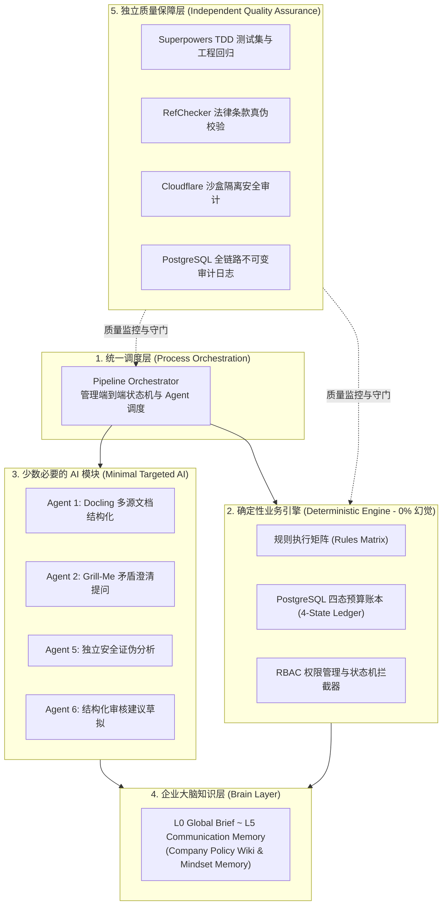

# 09 - 六阶段实施路线图与实施进展追踪 (Roadmap & Progress Tracker)

## 1. 最终架构决策与核心架构蓝图 (Final Architectural Decision)

> **核心原则：** 我们的系统不是一个由十几个 LLM 自由聊天的失控 Agent 群，而是一个**工程确定性为主、大模型精准点缀、企业知识分层沉淀**的高可靠企业级生产系统。



---

## 2. 六阶段落地路线图与验收标准 (Six-Phase Implementation Roadmap)

每个阶段都具备清晰的建设内容、可验证的验收标准以及前置依赖，确保实施平稳推进：

| 实施阶段 | 核心建设内容 | 验收标准 (Acceptance Criteria) | 当前进度与状态 |
| :---: | :--- | :--- | :---: |
| **Phase 1**<br/>基础内核 | • 统一 Pydantic JSON 数据结构<br/>• 建立基础规则矩阵与术语表<br/>• 部署 PostgreSQL 四态预算账本与行级锁<br/>• 编写不可变审计日志表结构 | **一份正常的合规申请能够从头至尾在测试代码中走通所有检查并正确预留扣减预算。** | 🟡 架构设计完成<br/>(待跑通首批用例) |
| **Phase 2**<br/>摄入与澄清 | • 集成 Docling 多模态提取 (PDF/Excel/Email)<br/>• 设定置信度评分阈值熔断机制<br/>• 落实 Agent 2 与 Grill-Me 批量提问机制<br/>• 建立业务异常捕获与挂起通道 | **系统能自动识别缺件、发票金额矛盾与未知条件，正确挂起单据并输出针对性问题。** | 🟡 规范就绪 |
| **Phase 3**<br/>企业知识库 | • 搭建 `company-brain/` LLM-Wiki 知识目录<br/>• 录入正式政策、SOP 与案例库<br/>• 部署 L3 RAG 检索器与条款锚定逻辑<br/>• 配置 RefChecker 校验来源真实性 | **系统给出的每个判定结论与扣减依据，均能精准反查到具体政策条款与法律文件页码。** | 🟢 Wiki 目录初始化完成 |
| **Phase 4**<br/>审核与沟通 | • 落地 Agent 6 审核建议生成引擎<br/>• 实施 Response-to-Reviewers 四大原则<br/>• 部署严格的「未授权承诺禁令」过滤器<br/>• 搭建员工审批与修改草稿的操作界面 | **审批人员拥有唯一最终决定权；AI 仅生成规范草稿且绝无越权承诺。** | 🟡 模板与规则已就绪 |
| **Phase 5**<br/>心智与安全 | • 引入 Distill Skill 提炼管理层历史审批经验<br/>• 建立 Mindset Proposal 管理层审批流程<br/>• 实施 Cloudflare 安全审计双轨制与独立证伪沙盒 | **系统能复用已批准的特批经验改善建议排序；恶意 Prompt 或可疑附件在沙盒中被证伪阻断。** | 🟢 技能库已拉取 |
| **Phase 6**<br/>优化与基准 | • 实施文件哈希缓存（文件仅解析一次）<br/>• 实施精准剪枝检索与单轮访谈上限<br/>• 建立 Token/成本/延迟基准监控台<br/>• 上线运营、财务、管理层三大看板 | **全链路单据处理 Token 消耗大幅降低（90%+ 计算由代码执行），多维看板实时呈现。** | 📋 计划中 |

---

## 3. 全链路进展与文档链接索引 (Progress Link Matrix)

本系统所有组件与实施进展已完整关联至以下工作区文档与技能代码中：

```text
umochi-squad-partnerflow/
├── docs/
│   ├── README.md                                    # 项目主索引与痛点应对矩阵
│   ├── 00-architecture-and-pipeline.md              # 端到端事件合约与状态机
│   ├── 01-agent-intake.md                           # Phase 2: Intake Agent 规范
│   ├── 02-agent-validation.md                       # Phase 2: Validation Agent 规范
│   ├── 03-agent-rules-engine.md                     # Phase 1: Rules Engine 规范
│   ├── 04-agent-budget-claim-verification.md        # Phase 1: Budget 事务账本
│   ├── 05-agent-exception.md                        # Phase 5: Exception 双轨审计
│   ├── 06-agent-human-review-workflow.md            # Phase 4: Human Review 审核流
│   ├── 07-agent-audit-reporting.md                  # Phase 1 & 6: 审计与三大看板
│   ├── 08-brain-layer.md                            # Phase 3 & 5: 五层大脑与 Token 优化
│   └── 09-implementation-roadmap-and-progress.md   # [本文件] 整体路线图与进展追踪
├── company-brain/                                   # Phase 3: 企业知识底座 (LLM-Wiki)
│   ├── INDEX.md
│   ├── glossary/
│   ├── policies/
│   ├── workflows/
│   ├── cases/
│   ├── mindset/approved-principles.md
│   └── communication/review-templates.md
└── skills/                                          # Phase 2~5: 已拉取的技能库
    ├── grill-me/
    ├── grill-with-docs/
    ├── security-audit/
    ├── superpowers/
    ├── distill/
    ├── response-to-reviewers/
    └── boss-communication/
```

---

## 4. 下一步行动 (Action Checklist)
1. **运行环境验证：** 在 VS Code 中打开本目录确认所有相对链接均可点击跳转。
2. **初始化 Phase 1 数据库表结构：** 在 PostgreSQL 容器或本地实例中运行 `04-agent-budget-claim-verification.md` 中的账本与事务脚本。
3. **录入首份官方政策：** 在 `company-brain/policies/` 中填入公司的正式《渠道合作报销指南》。

