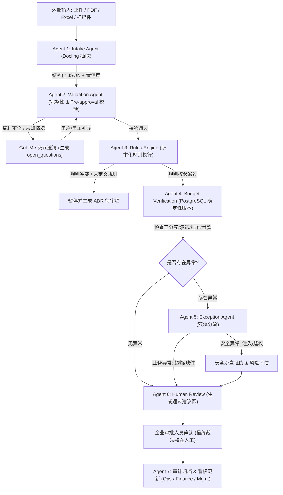

# Partner Claim & Pre-Approval Agent System (MVP Specification)

> **项目目标 (Mission):**
> 打造一个企业级合作伙伴预审批 (Pre-approval) 与报销 (Claim) 自动化处理系统，打通邮件、PDF、Excel 等散落资料，实现基于确定性规则与预算账本的自动化筛查，识别异常并由员工保持最终决策权，同时提供运营、财务及管理层实时看板与全流程审计追踪。

---

## 📑 文档导航 (VSCode Markdown List)

本规范已按 Agent 与核心模块拆分为独立的 Markdown 文档，便于团队在 VS Code 中分别查看、维护与实现：

| 序号 | 模块 / Agent | 核心文件路径 | 核心定位与技术栈 |
| :--- | :--- | :--- | :--- |
| **00** | **系统架构与运转链路** | [`00-architecture-and-pipeline.md`](./00-architecture-and-pipeline.md) | 端到端流转、状态机、JSON 合约规范、链路如何串联与 Validate |
| **01** | **Agent 1: Intake Agent** | [`01-agent-intake.md`](./01-agent-intake.md) | 多模态资料解析 (Docling)、Pydantic Schema、置信度标注、Token 优化 |
| **02** | **Agent 2: Validation Agent** | [`02-agent-validation.md`](./02-agent-validation.md) | 完整性验证、预审批勾稽、未知情况澄清 (Grill-Me 循环) |
| **03** | **Agent 3: Rules Engine** | [`03-agent-rules-engine.md`](./03-agent-rules-engine.md) | 规则设计访谈 (Grill-With-Docs)、规则编译矩阵、边界测试与版本化执行 |
| **04** | **Agent 4: Budget & Claim** | [`04-agent-budget-claim-verification.md`](./04-agent-budget-claim-verification.md) | 确定性业务计算、PostgreSQL 四态预算账本 (Allocated/Committed/Approved/Paid)、幂等防护 |
| **05** | **Agent 5: Exception Agent** | [`05-agent-exception.md`](./05-agent-exception.md) | 业务/安全双轨分流、Cloudflare 审计理念、沙盒化验证与证伪机制 |
| **06** | **Agent 6: Human Review** | [`06-agent-human-review-workflow.md`](./06-agent-human-review-workflow.md) | 审批建议函/补件通知生成 (Response-to-Reviewers 理念)、来源约束、禁止虚构承诺 |
| **07** | **Agent 7: Workflow & Reporting** | [`07-agent-audit-reporting.md`](./07-agent-audit-reporting.md) | 全程审计日志、Superpowers 开发方法学、RefChecker 校验、三大内部看板 |
| **08** | **Brain Layer 企业大脑** | [`08-brain-layer.md`](./08-brain-layer.md) | L0 全局记忆至 L5 沟通模板、LLM Wiki + RAG 证据双轨制、Token 深度优化 |
| **09** | **实施路线图与进展追踪** | [`09-implementation-roadmap-and-progress.md`](./09-implementation-roadmap-and-progress.md) | 六阶段落地计划、验收标准、最终架构蓝图与进度追踪 |
| **10** | **企业管理控制台与资料设置向导** | [`10-enterprise-admin-setup-wizard.md`](./10-enterprise-admin-setup-wizard.md) | GOV.UK/DWP 规范、4步向导 (Upload/Review/Resolve/Analyze)、10类资料解析、状态机反馈 |
| **11** | **系统全架构交叉核验与一致性报告** | [`11-architecture-cross-check-report.md`](./11-architecture-cross-check-report.md) | 端到端链路贯通性、5大不变量、极端边界压测 (并发/OCR错漏/注入/冷启动) 100% 通过验证 |
| **UI** | **Web 前端与规则中心交互规范** | [`web.md`](./web.md) | 纯白极简风、UMochi Squad 品牌、三大页面 (Listing History / Submission / **Company Brain & Policy Center** 从零渐进配置) |
| **AV** | **宣讲视频分镜与 CMO 演讲台本** | [`video.md`](./video.md) | 10页幻灯片结构、AI 生图提示词 (#72CDFF-#BFFFCC 主题)、B2 级全英文演讲稿与 AI 视频转场提示词 |

---

## 🧠 企业大脑知识目录 (Company Brain)

已初始化的企业知识中心位于工作区 [`../company-brain/`](../company-brain/) 目录：
- [`company-brain/INDEX.md`](../company-brain/INDEX.md) — 知识中心主索引
- [`company-brain/glossary/`](../company-brain/glossary/) — 统一业务术语表 (Tier, Budget 等)
- [`company-brain/policies/`](../company-brain/policies/) — 正式生效政策库 (预审批、报销上限等)
- [`company-brain/workflows/`](../company-brain/workflows/) — 状态机与异常处理 SOP
- [`company-brain/cases/`](../company-brain/cases/) — 历史典型判例
- [`company-brain/mindset/approved-principles.md`](../company-brain/mindset/approved-principles.md) — 经管理层批准的裁量原则 (L4)
- [`company-brain/communication/review-templates.md`](../company-brain/communication/review-templates.md) — 统一沟通与审核建议模板 (L5)

---

## 🗂️ 待解析企业原始资料库 (Client Documents)

在项目工作区根目录下已配置并归档好企业现存的 10 类核心业务文件清单 [`../client-documents/`](../client-documents/)：
- [`client-documents/README.md`](../client-documents/README.md) — 10 份核心文件与抽取目标索引清单
- `01-pre-approval-form.pdf` 至 `10-approval-authority-matrix.pdf` 及历史判例案例库

---

## 🧰 已拉取的技能目录库 (Downloaded Skills Folder)

所有在架构与各 Agent 中引用的开源/定制技能已拉取并保存在工作区的 [`../skills/`](../skills/) 目录下，包含完整的 `SKILL.md` 与验证脚本：

- [`skills/grill-me/`](../skills/grill-me/SKILL.md) - 矛盾与缺口访谈提问技能 (Agent 2)
- [`skills/grill-with-docs/`](../skills/grill-with-docs/SKILL.md) - 政策设计审查与 ADR 生成技能 (Agent 3)
- [`skills/security-audit/`](../skills/security-audit/SKILL.md) - Cloudflare 安全审查、沙盒与证伪套件 (Agent 5)
- [`skills/superpowers/`](../skills/superpowers/SKILL.md) - TDD、系统化调试与工程质量保证套件 (Agent 7 & 系统研发)
- [`skills/distill/`](../skills/distill/SKILL.md) - 管理层历史经验与判断原则提炼技能 (Brain L4)
- [`skills/response-to-reviewers/`](../skills/response-to-reviewers/SKILL.md) - 证据链锚定、防虚构承诺审核回复草拟技能 (Agent 6)
- [`skills/boss-communication/`](../skills/boss-communication/SKILL.md) - 面向高管/运营/财务/伙伴的企业沟通规范 (Brain L5)

---

## 🎯 MVP 核心能力与业务对齐矩阵

| 业务痛点 (Pain Point) | 系统应对 Agent / 模块 | MVP 实现机制 (How It Works) | 校验方式 (Validation) |
| :--- | :--- | :--- | :--- |
| **重复录入与手动文件核对** | Agent 1 (Intake) + Agent 2 (Validation) | Docling 自动抽取多源文档，输出统一 JSON Schema 并保留原文件页码/坐标 | 字段级置信度评分，低于阈值触发人工复核 |
| **规则冲突与理解漏洞** | Agent 3 (Rules Engine) | 规则编译前经 Grill-With-Docs 审查，生成 ADR 与规则矩阵 | 规则单元测试套件 + 边界测试 |
| **预算重复扣算与并发风险** | Agent 4 (Budget & Claim) | 抛弃 LLM 计算，使用 PostgreSQL 行级锁事务与原子账本 (4 状态) | 幂等操作 ID + 财务对账核对 |
| **异常调查耗时、安全威胁** | Agent 5 (Exception) | 业务/安全双轨分离，安全威胁走独立 Agent 证伪沙盒 | Confirmed / Needs_validation / Rejected 三态闭环 |
| **审批人重复阅读、草拟通知繁琐** | Agent 6 (Human Review) | 基于证据链生成结构化复核建议书与补件通知，不作未授权承诺 | 审批人最终确认 (Final Authority Kept with Company) |
| **状态/时效无追踪、各自汇报** | Agent 7 (Audit & Reporting) | 统一状态机、Ageing 时效计算、运维/财务/管理层多维度看板 | 唯一 `submission_id` 全链路审计日志追踪 |
| **规则分散在员工脑中** | Brain Layer (L0-L5) | 沉淀 Policy Wiki、Mindset Memory (Distill 经验提炼) 与沟通模板 | 知识需管理层批准入库，不自动猜测规则 |

---

## 🔄 全系统端到端流转概览

---

## 🛠️ 建议工作区配置

建议将 VS Code 当前工作区设置为：
`C:\Users\Alyssa Woe\.gemini\antigravity\scratch\umochi-squad-partnerflow`

这样可以在 VS Code 资源管理器中一览所有文档、快速跨文档跳转与代码开发。

